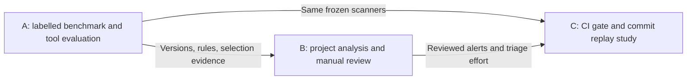
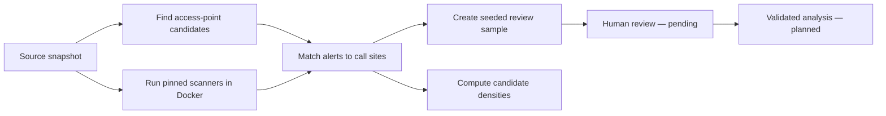

# Topic B — progress presentation

**Raw SQL, Query Builders or ORMs? How Database Access Style Affects Static Analysis Findings**

Progress checkpoint: 11 November 2026. Scope: Python and JavaScript. This document is a seven-part presentation outline, with speaker notes and a short demo. It presents completed engineering work and synthetic pilot observations; it does not report a completed empirical study.

## 1. What are we investigating?

Applications can access relational databases through raw SQL, query builders or ORMs. We want to measure whether access style is associated with the number and accuracy of SQL-related static-analysis findings.

Our research questions are:

1. How are these access styles distributed across selected open-source applications?
2. Does finding density differ between styles?
3. What share of findings in each style are real problems after manual review?

**Say:** “Our unit of analysis is a database-access call site. We will measure findings relative to how much database-access code exists, rather than comparing raw alert totals across projects of different sizes.”

## 2. How A, B and C connect



| Topic | Responsibility | Current handoff |
|---|---|---|
| A | Evaluate tools against known safe/unsafe examples | 16-case pilot benchmark, pinned scanners and local rules; final tool ranking pending |
| B — our work | Classify access points, map findings, review alerts and compare styles | Working synthetic pipeline, candidate densities and review queue |
| C | Measure policy effects, pipeline overhead and triage/fix costs | Policy illustration only; real replay work deferred |

**Say:** “B can develop its workflow while A is still evaluating tools. Our current scanners are integration candidates, not an established best pair.”

## 3. What we have built



Implemented components:

- Python AST-based and JavaScript lexical access-point candidate detection.
- Candidate labels: `raw`, `query_builder`, `orm`; unresolved alert locations remain separate.
- Semgrep CE 1.185.0 and Opengrep 1.33.1 with tracked local pilot rules; Bandit 1.9.4 B608 as a Python-only baseline.
- Normalized CSV findings with stable IDs, tool/rule/location/severity, mapped access ID and candidate style.
- Reproducible sampling with seed `20261111`; human verdict/evidence/time fields start empty.
- Separate run directories, protected review files, scanner-failure checks and provenance including source/rule hashes.

**Say:** “The automated classifier proposes labels. It does not establish that every database access has been found or correctly classified. That requires a manual source audit.”

## 4. What the synthetic pilot produced

Two small source files — one Python and one JavaScript — exercise the workflow. They are fixtures we wrote, not open-source projects in the empirical cohort.

| Language | Raw candidates | Query-builder candidates | ORM candidates | Total |
|---|---:|---:|---:|---:|
| Python | 2 | 0 | 1 | 3 |
| JavaScript | 1 | 1 | 1 | 3 |
| **Total** | **3** | **1** | **2** | **6** |

| Tool | Python alerts | JavaScript alerts | Total tool alerts |
|---|---:|---:|---:|
| Semgrep | 1 | 1 | 2 |
| Opengrep | 1 | 1 | 2 |
| Bandit | 1 | Unsupported | 1 |
| **Total** | **3** | **2** | **5** |

The five tool alerts map to **two distinct candidate call sites**. All five mapped successfully; there are no unresolved mappings in this fixture. All six access candidates remain pending audit and all five alert reviews remain `unreviewed`.

**Say:** “Five alerts do not mean five vulnerabilities. Multiple tools flagged the same call sites. This pilot demonstrates that collection, mapping and sampling work; it does not demonstrate prevalence or precision in real software.”

Evidence: [access_points.csv](evidence/access_points.csv), [findings.csv](evidence/findings.csv), [review.csv](evidence/review.csv).

## 5. How we will compare styles

For each tool, project and access style:

**Finding density = tool alerts mapped to that style ÷ audited access points of that style × 100.**

We also report unique flagged call sites so duplicate alerts do not obscure the distinction between alert volume and affected locations. Density is not a probability and can exceed 100 when several alerts map to one point.

Corrected **synthetic candidate densities**, in alerts per 100 candidate access points:

| Language and style | Points | Semgrep | Opengrep | Bandit |
|---|---:|---:|---:|---:|
| Python raw | 2 | 50 | 50 | 50 |
| Python ORM | 1 | 0 | 0 | 0 |
| JavaScript raw | 1 | 100 | 100 | Unsupported |
| JavaScript query builder | 1 | 0 | 0 | Unsupported |
| JavaScript ORM | 1 | 0 | 0 | Unsupported |

Python has no query-builder point in this fixture, so that density is undefined, not zero.

**Say:** “These numbers explain our calculation. We cannot conclude that ORMs are safer: the examples are synthetic, classifications are unaudited, and tool coverage differs.”

Evidence: [report.json](evidence/report.json). This uses the corrected per-tool aggregation; see the evidence provenance note.

## 6. What is incomplete, and why it matters

| Gap | Consequence | Next action |
|---|---|---|
| No real repository pinned or scanned | We cannot answer RQ1–RQ3 about open-source applications yet | Screen and pin an initial application in each language |
| Candidate list includes libraries and unchecked language/database choices | It is not a valid 20-project cohort | Apply explicit eligibility criteria and record exclusions |
| Candidate detection is heuristic, especially JavaScript | Counts may omit wrappers or include non-database calls | Audit full production-source scope and receiver semantics |
| Semgrep and Opengrep share ancestry and the same pilot rules | Agreement is not independent confirmation | Team A must justify the final tool pair and profiles |
| No finding has been manually reviewed | Precision and false-alarm cost are unknown | Review source-to-query flow and record evidence |
| Build dependencies are not fully hash-locked | Rebuilding later may resolve different dependencies | Archive/freeze the working image before collecting study data |

No statistical significance, vulnerability prevalence, comparative safety claim or real CI benefit is claimed at this stage.

**Say:** “Our deliverable today is a working measurement workflow and a documented study design. The next work is collecting and auditing real evidence.”

## 7. Next checkpoint and proposed work split

The next checkpoint is **one eligible Python application and one eligible JavaScript application**, each at a fixed commit, with:

- An eligibility record, license, database/framework identification and explicit source scope.
- A candidate inventory followed by a full-scope manual audit.
- Successful scanner runs and checked alert-to-access-point joins.
- Reviewed findings with evidence; actual counts reported even if there are few or no alerts.
- A short limitations note and an agreed decision on scaling to 20 applications.

Within Team B, divide work into cohort/snapshot preparation, classification/auditing, scanner/data engineering, and finding review/analysis. These are responsibilities, not a requirement for four separate people. Cross-review a subset where possible.

Team A owns final tool/profile selection. Team C can use B's eventual review data, but should wait for real labels and measured effort before claiming triage-cost results.

**Closing statement:** “We have demonstrated the data pipeline on six synthetic access points. Our next milestone is to validate it on two real applications before expanding the study.”

## Optional live demo — about three minutes

Run from the repository root, with the already built Docker image:

```bash
make test
make b
make c
cat artifacts/b/latest.json
```

`make b` prints its new run directory. Open that run's `access_points.csv`, `findings.csv`, `review.csv` and `report.json` in that order. Show how an alert's `access_id` points to a candidate call site and how the review queue adds verdict/evidence fields. Do not rerun `make a` just to demonstrate B.

If Docker is unavailable during the presentation, use the frozen files in `evidence/`. The evidence directory is intentionally shareable even though live `artifacts/` is ignored by Git. See [evidence/README.md](evidence/README.md) for provenance.
